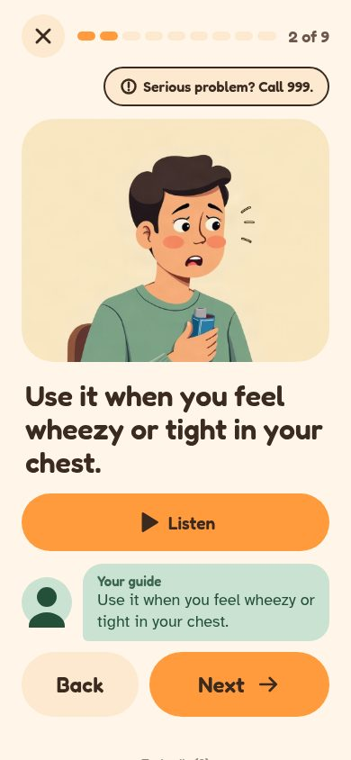
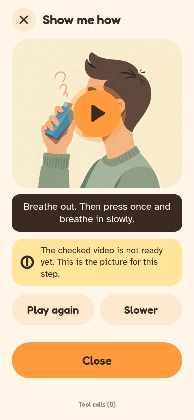
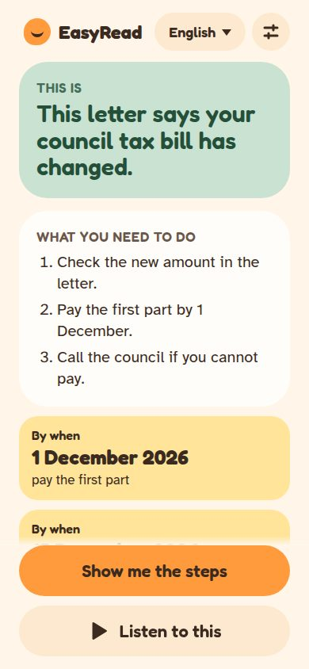
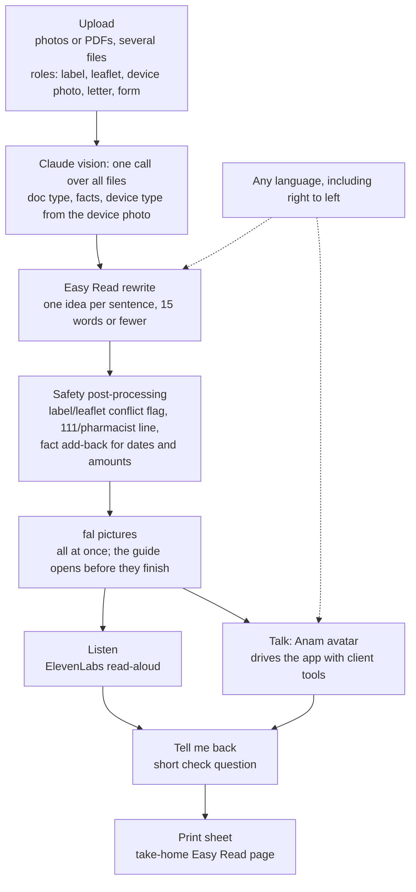
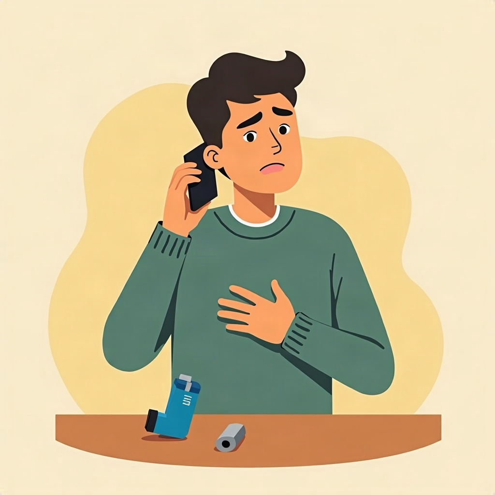
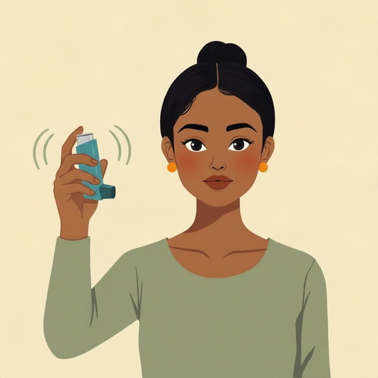
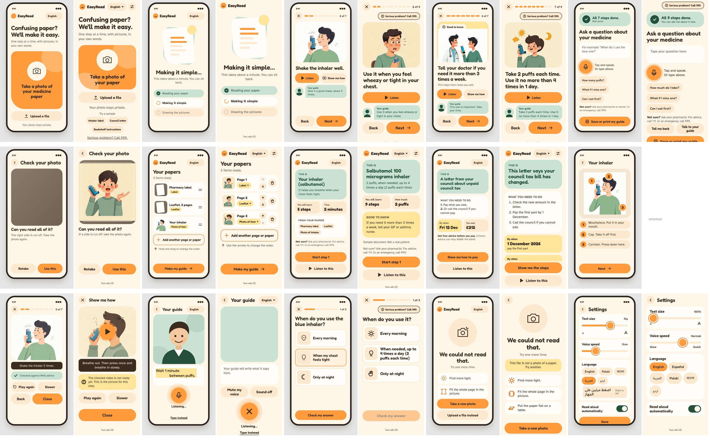

# EasyRead AI

Take a photo of a confusing paper. Get an Easy Read guide: short steps, a picture for each step, read aloud, in your own language.

<table>
<tr>
<td align="center" valign="top"><br>One step, one picture, one sentence.</td>
<td align="center" valign="top"><br>Show me how: a short clip.</td>
<td align="center" valign="top"><br>A council letter, made easy.</td>
</tr>
</table>

Built for Imperial AI Hack 2026, Track 03: Voice, Vision & Generative Media.

> The guide explains the paper you give it. It does not give medical advice, diagnose, or change a dose. All sample papers in this repo are fictional.

## The problem

- Easy Read (one short sentence and one picture for each idea) is an established format. It is written by hand, so almost no medicine label, letter or bill comes in Easy Read.
- It helps people with learning disabilities, people with low literacy, people who do not read English well, older people, and the carers who read papers for them.
- A misread medicine label or a missed payment date has real costs.

**Built for medicines, works on any paper.** We built and tested it mainly on medicine (an inhaler label, its leaflet and a photo of the inhaler). The same engine handles letters, bills, forms and other how-tos.

## Contents

- [How it works](#how-it-works)
- [fal in EasyRead](#fal-in-easyread)
- [Anam in EasyRead](#anam-in-easyread)
- [Designed in Figma](#designed-in-figma)
- [Fine-tuned with Adaption](#fine-tuned-with-adaption)
- [Safety](#safety)
- [Tested on real-style papers](#tested-on-real-style-papers)
- [What works today](#what-works-today)
- [Run it](#run-it)
- [APIs, models and datasets](#apis-models-and-datasets)
- [Team](#team)

## How it works



1. **Upload.** Add one or more photos or PDFs. Each file has a role (label, leaflet, device photo, letter, form, other). You set it, or the server detects it.
2. **Read.** All files go to Claude in one vision call. It returns the document type (how-to, letter, bill, form), the facts, and anything it could not read. A device photo sets `device_type` (for example a pressurised inhaler is shaken; a dry-powder inhaler is not). That decides the technique steps. A photo that is not a paper, or cannot be read, stops with a clear message.
3. **Rewrite.** Facts become Easy Read steps (`finetune/`, `agent/pipeline.py`). Letters, bills and forms get what it is, what to do, by when, and how much.
4. **Post-process.** Pure Python checks tidy the steps (`agent/postprocess.py`, `agent/doctypes.py`). See [Safety](#safety).
5. **Pictures.** fal draws one picture per step, all at once (`PICTURE_CONCURRENCY`, default 9; a 9-step guide took 12 s in our test). The guide opens as soon as the steps are written. Pictures stream in over SSE.
6. **Listen and talk.** ElevenLabs reads each step aloud (`/api/tts`, browser voice as fallback). The Anam avatar talks you through the guide.
7. **Check and take home.** "Tell me back" asks a short check question. `/api/guides/{id}/sheet` returns a printable page.
8. **Any language.** Pick a language, or type one. Steps, safety lines and the avatar switch. Arabic, Urdu, Persian, Pashto, Hebrew and other right-to-left languages flip the layout. The interface is hand-translated in English, Spanish, Arabic, Urdu and Polish (Bengali is not finished).

`CONTRACTS.md` has the exact Guide JSON, API and tool definitions.

## fal in EasyRead

Every step has a picture. The pictures carry the meaning, so they work in any language. fal makes all of them. Code: `media/fal.py`, called from `agent/pipeline.py`.

| fal model | Where it is used | Status |
|---|---|---|
| `fal-ai/nano-banana/edit` | Live step pictures for every uploaded paper. One character: the guide portrait (`media/guide_ref.jpg`, from `design/guide-cartoon/chosen.png`) goes with every request as a reference image, so the woman in every step is the live guide. One shared style prompt (the app palette), no text inside the image. About 9 s per picture, all made in parallel. See `design/one-character/sheet.png` | Live, needs `FAL_KEY` |
| `fal-ai/flux/dev` | The cartoon portrait the Anam guide avatar is made from (`design/guide-cartoon/`). Was the step-picture model before; it drew a different person in each step | Offline |
| `fal-ai/flux/schnell` | Pictures for the council letter and bookshelf sample guides, made once and stored in `demo/fixtures/img/` (the inhaler sample uses the live model with the guide). Also in the model comparison (`media/samples/compare/schnell.jpg`) | Offline, stored in the repo |
| `fal-ai/kling-video/v2.5-turbo/standard/image-to-video` | 3 technique clips made from the step pictures: shake, press and breathe in, hold your breath (`library/clips/`) | Made offline. Not checked by a pharmacist, so shown only in demo mode (`SHOW_UNCHECKED_CLIPS=1`) with a "not yet checked" badge |
| `fal-ai/flux-kontext/dev` | Labels on the user's own device photo (cap, mouthpiece, canister) | Built (`label_device_photo` in `agent/pipeline.py`). Off by default (`DEVICE_PHOTO_LABELS=1` turns it on), because live tests put the labels beside the parts, not on them |

Step pictures from the sample guides (inhaler, council letter, bookshelf) and a clip poster:

<table>
<tr>
<td align="center"><br>Shake the inhaler 4 times.</td>
<td align="center"><br>Press once and breathe in.</td>
<td align="center"><br>Hold your breath for 10 seconds.</td>
<td align="center"><br>Cannot breathe? Call 999.</td>
</tr>
<tr>
<td align="center"><br>Your council tax has changed.</td>
<td align="center"><br>Pay the first part by 1 December.</td>
<td align="center"><br>Join the 2 sides with 4 screws.</td>
<td align="center"><br>Kling clip: shake (poster frame).</td>
</tr>
</table>

Why fal is central:

- Every step has a picture. Without fal, a guide is only text, which is the problem we are solving.
- The pictures have no words in them. The same picture works in every language, and it can never show a wrong dose. Captions come from the app in the chosen language.
- One style prompt keeps every picture in one look across a guide.
- Pictures are made all at once (about 12 s for 9) and stream in, so the user starts reading straight away.
- We chain 4 fal models: text-to-image (two models), image-to-video from those pictures, and image edit on the user's own photo.

## Anam in EasyRead

The avatar talks you through the guide and drives the app with client tools. Code: `agent/persona.py` (persona and tools), `agent/main.py` (`POST /api/anam/session`), `web/src/useAnam.ts` (SDK client), `web/src/App.tsx` (tool handlers).

**Persona.**

- Avatar: our own cartoon guide, a custom `cara-4` avatar made from one `fal-ai/flux/dev` portrait in the same flat style as the step pictures (`design/guide-cartoon/chosen.png`), so the guide and the pictures look like one product. `ANAM_AVATAR_ID` overrides it (the realistic stock avatar "Liv" is the fallback, see `.env.example`). Anam's built-in LLM (GPT OSS 120B). We keep Anam's own LLM because the tool calls are the point.
- Voice "Amanda - Warm Guide" by default. Anam voices are single-language, so `ANAM_VOICE_ID_<LANG>` (for example `ANAM_VOICE_ID_ES`) sets a voice per language. `tools/anam_voices.py` lists candidates.
- Speech recognition is set to the user's language when Anam supports it. Otherwise the user can type.
- The server builds the persona and asks Anam for a session token. The browser gets only the token, never the key.

**Client tools.** All are `type: "client"`, `awaitResult: true`, timeout 30 s. Each returns a short line for the avatar to say.

| Tool | What it does | Example |
|---|---|---|
| `show_step` | Opens a step by number and returns its text | "Show me step 3." |
| `next_step` | Moves to the next step | "Next." |
| `previous_step` | Goes back one step | "Go back." |
| `play_technique` | Opens the technique clip for a step. Says if the clip is not checked yet, or that there is no checked video | "Show me how to press it." |
| `answer_from_document` | Answers a question from the document only (server `/api/guides/{id}/ask`) | "How many puffs do I take?" |
| `check_understanding` | Asks a "tell me back" question, or checks the user's reply | "Am I doing it right?" |
| `set_language` | Switches the guide, captions and the avatar's listening language | "Can you say it in Arabic?" |

**The guide as context.** When a session starts, the server puts the guide into the persona's system prompt: document type, facts, content, safety lines and every Easy Read step, plus the ground rules (`agent/persona.py`, `system_prompt`). The avatar starts on the step the user is on.

**One avatar across screens.** There is one `<video>` element for the avatar. It moves to a slot on each screen (step, ask, talk), so the session and the video keep running as you move around the app (`web/src/screens/guide.tsx`).

**Safety boundary.**

- The prompt tells the avatar to answer questions only through `answer_from_document`. That tool runs the same grounded Q&A as the Ask screen.
- If the answer says 111, the tool adds "Call 111 for urgent advice" to what the avatar says.
- The prompt also tells it: never give medical advice or change doses, and use only library clips.

**Evidence: the Tool calls panel.** Every tool call, from the avatar or from an on-screen button, is logged with its arguments, time taken and the line returned. Open **Tool calls (n)** at the bottom of the screen to see it (`DevPanel` in `web/src/screens/settings.tsx`).

## Designed in Figma

Figma file: https://www.figma.com/design/tNc9gbdjtkrXMAgsvRT30w (15 phone frames, 390 x 844).

We designed the screens in Figma first, then built `web/` to match. The colour, type and radius tokens in `web/src/styles.css` come from the file.

Design principles for low literacy:

- **One idea per screen.** One picture, one short sentence (15 words or fewer), one big Next button.
- **Big type.** Steps 32px, body 20px, buttons 22px, tap targets at least 64px. A text-size setting scales everything.
- **High contrast.** Dark brown ink (#3A2A20) on warm cream (#FFF6E9). One orange colour for the main action. Atkinson Hyperlegible for body text, a typeface made for low-vision readers.
- **Read-aloud everywhere.** A Listen button on every step and summary, and a talking guide. Every spoken line also shows as a caption.
- **Pictures without words.** The same picture works in every language.
- **Right to left.** Arabic, Urdu and other right-to-left languages flip the whole layout.
- **Plain words.** Buttons are short verbs ("Take a photo", "Make my guide"). Errors say what went wrong and what to do.

Figma (left) next to the built app (right), for every screen:



Full table with routes: [design/EVIDENCE.md](design/EVIDENCE.md). Writing rules: `docs/STYLE.md`.

## Fine-tuned with Adaption

**What the model does.** It is an Easy Read writer: extracted facts in, Easy Read steps out (one idea per sentence, 15 words or fewer, numbers as digits, a picture description for each step).

**Dataset.**

- 555 seed rows built in this repo (`finetune/build_dataset.py`) from fictional fact sets (`finetune/seeds.py`), plus rows generated by Adaption.
- Every row is filtered by our Easy Read rubric (`finetune/rubric.py`, `finetune/adaption_run.py filter`). 1,161 rows passed.
- Mixed papers: medicines, letters, bills and forms. All fictional. Held-out seeds are never used for training.

**Run.** On Tasnim's Adaption account. AutoScientist run `6ab34ef1`. Base model `Qwen/Qwen3.5-4B`. Best win rate against the base model: **0.7712** (77% of held-out rewrites preferred over the base model; target 0.7). Details: [finetune/RESULTS.md](finetune/RESULTS.md).

Adaption does not yet offer inference on tuned models, so the live app writes steps with Claude and the fine-tune is shown by its win rate.

**Honest note.** The live app writes the steps with Claude. The rewriter in `finetune/__init__.py` switches to the tuned model when `ADAPTION_MODEL_ID` and `ADAPTION_API_KEY` are set.

**Rubric.** `finetune/rubric.py` checks step count, sentence length, jargon, digits, dose and timing kept, no invented numbers, warning and get-help steps, and a picture prompt per step. A second rubric checks that every date and amount in a letter, bill or form survives. `python -m finetune.eval` compares models on held-out seeds.

## Safety

Ground rules, and where the code enforces them:

| Rule | How it is enforced |
|---|---|
| Explain the user's paper only. No medical advice, no diagnosis, no dose changes | Prompts for extraction, rewrite, Q&A and the avatar (`agent/pipeline.py`, `agent/qa.py`, `agent/persona.py`) |
| Urgent questions: call 111 | `agent/qa.py` matches urgent words and returns 111. The app adds no 999 line or link; a 999 line printed on the paper itself is kept |
| Out-of-scope questions are refused | If the answer is not in the document, Q&A returns "ask your pharmacist or GP" (or free advice for non-medicine papers) |
| Label and leaflet disagree | The guide shows one fixed flag, "Your label and leaflet say different things. Ask your pharmacist.", and never picks a dose (`postprocess.normalise_conflict`, `doctypes.finish_steps`) |
| Every guide ends with a safety line | Medicine: 111, pharmacist or GP. How-to: stop and ask for help. Letter, bill, form: get free advice (`doctypes.safety_lines`, added if missing) |
| Never drop or invent facts | Any date, time or amount the rewrite dropped is added back as its own step (`doctypes.ensure_content_facts`). Unreadable parts are listed and the guide says so |
| No text inside pictures | The fal prompt forbids text, so a picture cannot show a wrong dose |
| Technique clips only from a checked library | A clip shows only when `checked_by`, `checked_against` (an nhs.uk page) and `checked_at` are set. None are checked yet. Demo mode (`SHOW_UNCHECKED_CLIPS=1`) shows them with a "Not yet checked by a pharmacist" badge, and the avatar says so |
| Demo data is labelled | All sample papers are fictional. Sample guides show "Sample document. Not a real patient." and the print sheet says "Sample only. Not a real person." |
| Keys stay on the server | The browser gets only an Anam session token |

Limits: the keyword list is not clinical triage, and answers have not been clinically reviewed. Do not use this as your only source for taking a medicine.

## Tested on real-style papers

Fictional papers in `demo/inputs/realistic/` test the real upload path on messy input.

| File | What it tests | Expected |
|---|---|---|
| a_council_photo.jpg | council letter photographed at an angle, blur, shadow | amounts and date exact |
| b_inhaler_dim.jpg | dim, low-contrast medicine label | reads dose; no spacer unless the label says always |
| c_gp_letter.pdf | 2-page GP appointment letter (PDF) | date, time, room, fasting incl. "you may drink water", 999/111 line |
| d_eyedrops_label.jpg | eye drops label | 1 drop, both eyes, 4 times a day, 5 days, discard after 28 days |
| e_discharge.png | dense hospital discharge letter | one step per medicine change, follow-ups kept |
| f_spanish_school.png | Spanish school letter | guide in the chosen language, trip date and times kept |
| g_not_document.jpg | a picture that is not a paper | friendly "not a paper" error |
| h1_bill.png | electricity bill | total £72.02 first, due date |
| h2_dd_form.png | direct-debit form | one step per box |
| i_unreadable.jpg | tiny blurred crop | friendly "unreadable, take a clearer photo" error |

Three sample guides work offline: an inhaler (`demo/fixtures/guide_inhaler.json`), a council letter (`guide_council_letter.json`) and a flat-pack bookshelf (`guide_flatpack.json`).

## What works today

| Part | Status |
|---|---|
| Upload, extraction, steps, pictures, translation, Ask | Working. Needs `ANTHROPIC_API_KEY`; pictures need `FAL_KEY` |
| Sample guides, all screens, settings, print sheet, Tool calls panel | Working with no keys |
| ElevenLabs voice | Working with `ELEVENLABS_API_KEY`; browser voice otherwise |
| Anam avatar | Working with `ANAM_API_KEY`. Without it the server returns a mock token and the app shows an illustrated stand-in |
| Technique clips | 3 clips made with fal Kling. Not checked yet, so shown only in demo mode with a badge |
| Labels on the user's device photo | Built, off by default (labels were misplaced in live tests) |
| Adaption fine-tuned rewriter | Trained on Tasnim's account. The live app uses Claude until `ADAPTION_MODEL_ID` is set |
| MongoDB | Optional. Guides stay in memory without `MONGODB_URI` |

## Run it

You need Python 3.12 and Node.

```bash
cp .env.example .env     # optional. With no keys, the sample guides still work
pip install -r requirements.txt
uvicorn agent.main:app --reload --port 8000
```

In a second terminal:

```bash
cd web && npm install && npm run dev
```

Open the URL Vite prints. The dev server sends `/api/*` to `http://localhost:8000`. On the home screen, choose a sample. You can also open one by URL, for example `/#/sample/council`.

With no keys, uploading your own paper does not make a real guide, because extraction needs a model. The samples, screens, language switch, settings and print sheet work.

Keys go in your own local `.env`, which is gitignored:

| Variable | Unlocks |
|---|---|
| `ANTHROPIC_API_KEY` | Extraction, rewriting, translation, grounded answers. `ANTHROPIC_MODEL` overrides the model |
| `FAL_KEY` | Step pictures. `PICTURE_CONCURRENCY` (default 9) sets how many are made at once |
| `ELEVENLABS_API_KEY` | Natural voice. `ELEVENLABS_VOICE_ID` and `ELEVENLABS_MODEL_ID` are optional |
| `ANAM_API_KEY` | Live avatar. `ANAM_AVATAR_ID`, `ANAM_VOICE_ID`, `ANAM_LLM_ID` are optional. `ANAM_VOICE_ID_<LANG>` sets a voice per language |
| `ADAPTION_API_KEY` and `ADAPTION_MODEL_ID` | Fine-tuned rewriter (also needs `pip install adaption`) |
| `MONGODB_URI` | Saved guides across restarts |
| `SHOW_UNCHECKED_CLIPS=1` | Demo only: show unchecked technique clips with a badge |
| `DEVICE_PHOTO_LABELS=1` | Turn on fal labels on the device photo (off by default) |

Tests:

```bash
EASYREAD_NO_DOTENV=1 pytest agent finetune media   # no keys needed
cd web && npm run build                            # type-check and production build
```

`GET /api/health` shows which keys the server can see.

## APIs, models and datasets

| Service | Model or ID | Used for | Where |
|---|---|---|---|
| Anthropic API (Claude) | `claude-sonnet-5-5` (default; `ANTHROPIC_MODEL` changes it) | Reading photos and PDFs, document and device type, Easy Read rewrite, translation, grounded Q&A, drafting training rows | `agent/llm.py` |
| fal | `fal-ai/nano-banana/edit` | Live step pictures (guide portrait as reference) | `media/fal.py` |
| fal | `fal-ai/flux/dev` | Guide avatar portrait | `design/guide-cartoon/` |
| fal | `fal-ai/flux/schnell` | Sample-guide pictures (offline) and model comparison | `demo/fixtures/img/`, `media/samples/compare/` |
| fal | `fal-ai/kling-video/v2.5-turbo/standard/image-to-video` | Technique clips, made offline | `media/fal.py`, `library/` |
| fal | `fal-ai/flux-kontext/dev` | Labels on the device photo (off by default) | `media/fal.py`, `agent/pipeline.py` |
| Anam | Avatar "Liv" (`cara-4`, id `071b0286-4cce-4808-bee2-e642f1062de3`); voice "Amanda - Warm Guide" (id `90313ddc-4fc0-11f1-84b0-52bacf74fa75`); LLM GPT OSS 120B, Anam's built-in model (id `a7cf662c-2ace-4de1-a21e-ef0fbf144bb7`); all overridable by env. Endpoints `POST /v1/auth/session-token`, `GET /v1/voices`; `@anam-ai/js-sdk` | Avatar, speech, client tool calling | `agent/persona.py`, `agent/main.py`, `tools/anam_voices.py`, `web/src/useAnam.ts` |
| ElevenLabs | Model `eleven_multilingual_v2`; default voice "Sarah" (`EXAVITQu4vr4xnSDxMaL`); `POST /v1/text-to-speech/{voice}`; replies cached on disk | Read-aloud (browser voice if no key) | `agent/tts.py` |
| Adaption | `adaption` SDK; AutoScientist run `6ab34ef1`, base `Qwen/Qwen3.5-4B`. Upload, augmentation, rubric filter and training in `finetune/adaption_run.py` | Fine-tuned Easy Read rewriter | `finetune/` |
| MongoDB Atlas | `pymongo` | Optional guide storage | `agent/store.py` |
| Figma | File `tNc9gbdjtkrXMAgsvRT30w` (earlier drafts: Figma Make) | App design | `design/` |
| Libraries | FastAPI, uvicorn, httpx, pypdf, React 18, Vite, TypeScript | App | `requirements.txt`, `web/package.json` |

Datasets: none from outside. The Easy Read training and evaluation sets are built in this repo (`finetune/build_dataset.py`, `finetune/seeds.py`) from fictional fact sets, drafted with Claude, extended by Adaption and filtered by the rubric. No real patient data. Sample papers and pictures in `demo/`, `library/` and `media/samples/` are fictional or generated.

NHS pages: each technique clip in `library/index.json` has a `checked_against` field for the nhs.uk page a person checks it against. All are empty for now. No NHS text or images are copied into the dataset, the app or the prompts.

## Team

- [@Tasnim-Uddin](https://github.com/Tasnim-Uddin): lead, server, extraction, Q&A, Anam persona
- [@Roddyw123](https://github.com/Roddyw123): web app, Figma design
- [@AhmedBlackEye](https://github.com/AhmedBlackEye): fal media and technique library
- [@rtkyboba](https://github.com/rtkyboba): fine-tune, evaluation, demo, README
