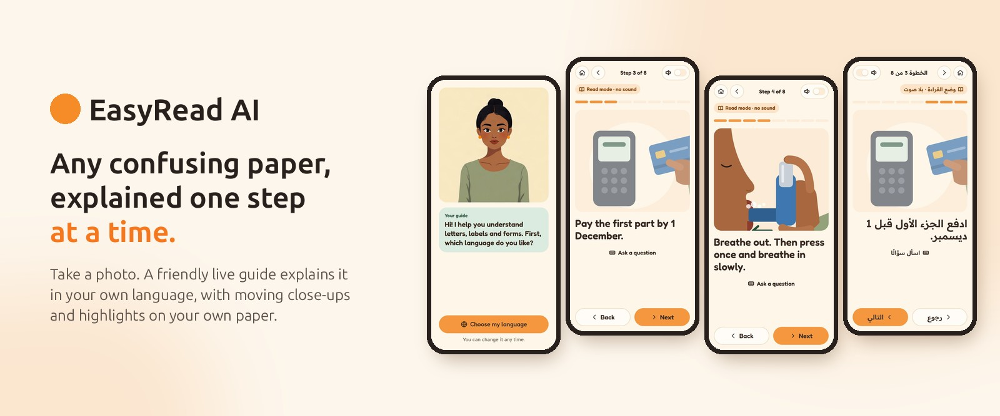
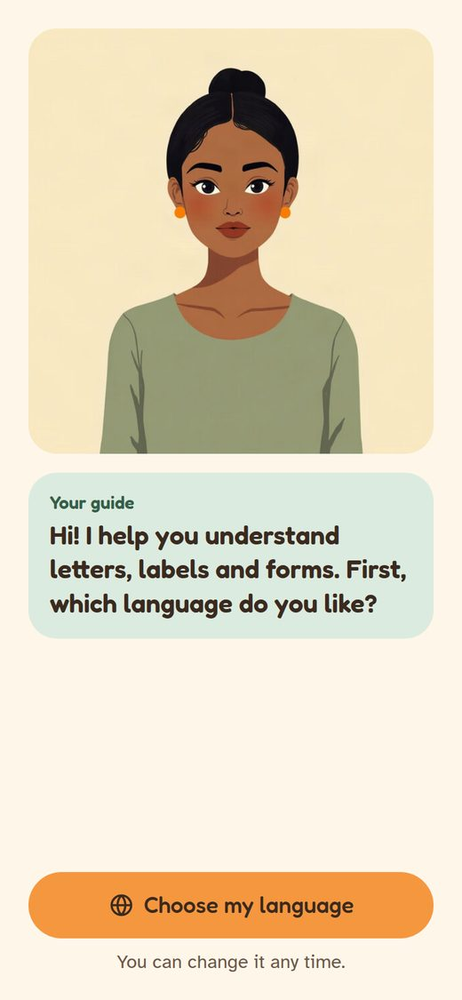
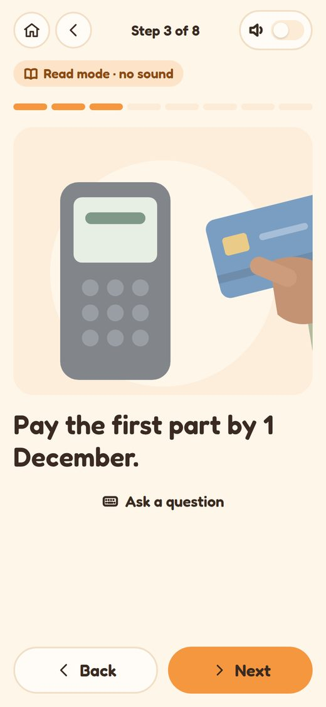
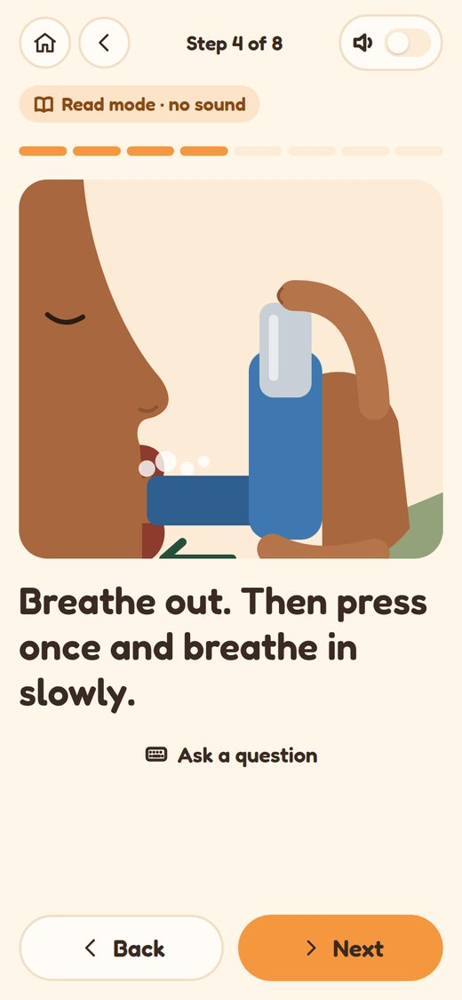
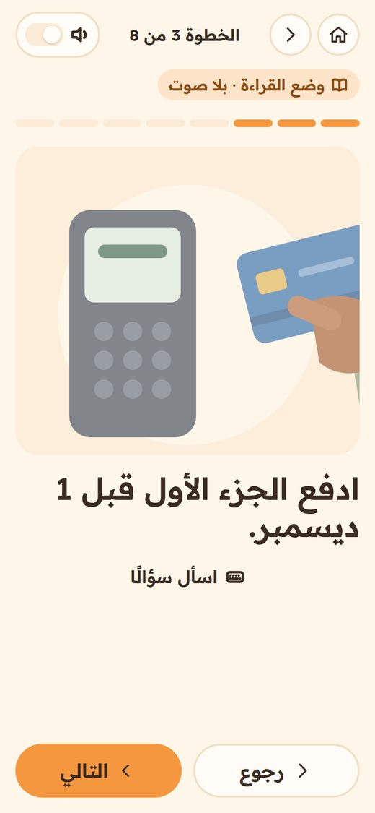
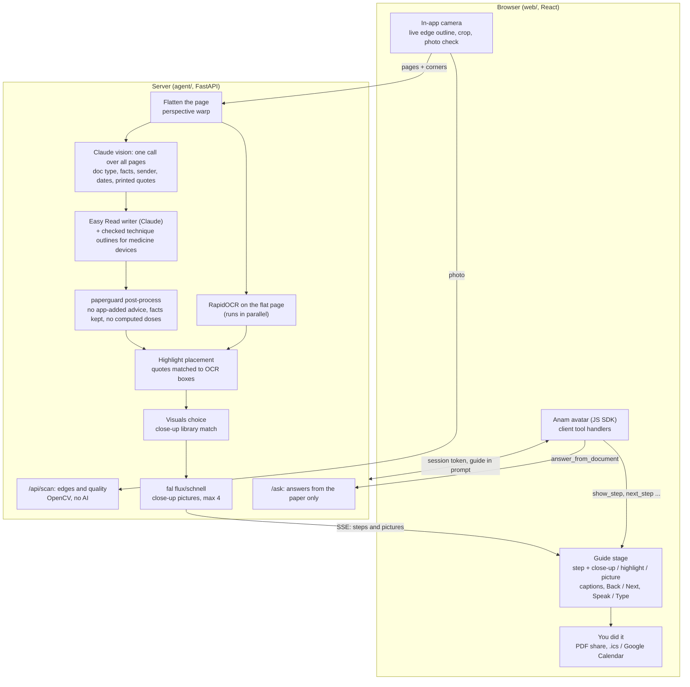

# EasyRead AI

**Take a photo of any confusing paper. A friendly live guide explains it to you, one short step at a time, in your own language.**



Built at Imperial AI Hack 2026 for **Track 03: Voice, Vision & Generative Media**.

<table>
<tr>
<td align="center" valign="top"><br>The guide says hello and asks your language.</td>
<td align="center" valign="top"><br>A letter: one step, one moving close-up.</td>
<td align="center" valign="top"><br>A medicine: the steps from a checked outline.</td>
<td align="center" valign="top"><br>Any language. Arabic flips the layout.</td>
</tr>
</table>

<sub>Screens from the built app on its sample papers, in Read mode (no live guide). With the live guide on, the guide sits in a circle in the corner and speaks each step, with captions.</sub>

> EasyRead AI explains the user's own paper. It does not add advice of its own, diagnose, or change a dose. All sample papers in this repo are fictional.

## Contents

- [The problem](#the-problem)
- [What it does](#what-it-does)
- [How it works](#how-it-works)
- [Safety and honesty](#safety-and-honesty)
- [fal in EasyRead](#fal-in-easyread)
- [Anam in EasyRead](#anam-in-easyread)
- [Designed in Figma](#designed-in-figma)
- [Fine-tuned with Adaption](#fine-tuned-with-adaption)
- [Everything we used](#everything-we-used)
- [Run it](#run-it)
- [Testing](#testing)
- [Limits and what's next](#limits-and-whats-next)
- [Team](#team)

## The problem

- **Easy Read** is an established format: one short sentence and one picture for each idea. It is made by hand, so almost no letter, bill, form or medicine label ever comes in Easy Read.
- The people who need it most get the hardest papers: people with learning disabilities, people with low literacy, people who do not read English well, and the carers who read papers for them.
- A missed payment date, a form left blank or a misread medicine label has real costs.

## What it does

**Any paper.** A letter, a bill, a form, a prescription, a medicine leaflet, a set of instructions.

1. **Take a photo in the app.** The camera finds the paper's edges as you hold it. You can drag the corners, rotate, add more pages, or pick a photo or PDF. A quick photo check warns about blur, glare, dark photos or cut-off pages before anything is sent.
2. **Get an Easy Read guide.** Short steps, one idea each, 15 words or fewer, numbers as digits. In any language you choose. It takes about 20 to 45 seconds in our tests.
3. **A live guide explains it.** An Anam avatar sits on a "guide stage". She speaks one step at a time, with captions, then waits. You move on with Back and Next. Each step shows the clearest visual it has:
   - **a highlight on your own photo**, outlining the exact printed words (an amount, a date, a phone number), found by OCR;
   - **an animated close-up** from our library of 45 hand-made animated SVG scenes (pay by card, phone call, sign here, shake the inhaler, and more);
   - **a fal close-up picture** (hands and the one object, no words), at most 4 per guide;
   - a big number card for the key amount or date.
4. **Read mode.** Turn the guide off with the book button. Same steps, no avatar, no sound, the full text on screen.
5. **Ask anything.** Press **Speak** (push to talk; the mic is off by default) or **Type**. Answers come only from your paper. If the paper does not say, the guide says so plainly and names who to ask: the sender printed on the paper ("That's not on your paper. Ask HMRC.").
6. **You did it.** At the end:
   - **Save or share** a one-page PDF of the guide (Share, Print, Save as PDF). **Share in** your language or in English, so a carer or support worker can read it too.
   - **Remind me** for each future date on the paper: a calendar file (.ics) or Google Calendar. Past dates are still stated in the steps, but never offered as reminders.
   - Ask more questions, by voice or by typing.
7. **My guides.** Every guide is saved on the phone's list, with automatic type chips (medicine, letters, bills, forms, how-to), search, rename and delete. Open one and it resumes on the step you left.

**Made for access.**

- Interface hand-translated into 6 languages: English, Spanish, Arabic, Urdu, Polish and Bengali. The guide's own content can be in any language.
- Right-to-left languages (Arabic, Urdu, Persian, Pashto, Hebrew and more) flip the whole layout.
- 5 text sizes, 4 colour themes, voice speed.
- Native guide voices in English, Spanish, Arabic and Polish. Other languages use a multilingual voice. Changing language restarts the guide in the new language, on the same step.
- Big type (Atkinson Hyperlegible), high contrast, tap targets of 64px or more, plain words on every button.

## How it works



1. **Scan.** The browser runs a small edge detector for the live camera outline. The server (`agent/scan.py`, OpenCV) gives more accurate corners and a photo check. Each page is flattened to an upright page before reading.
2. **Read.** All pages go to Claude in one vision call (`agent/pipeline.py`, `agent/llm.py`). It returns the document type (how-to, letter, bill, form), the facts, the sender, the dated actions, short exact quotes from the paper, and anything it could not read. A photo that is not a paper, or cannot be read, stops with a clear message.
3. **Write.** Facts become Easy Read steps. Letters, bills and forms get what it is, what to do, by when, and how much. For a medicine device (inhaler, spacer, eye drops, cream), the technique steps come from a fixed outline (`agent/technique.py`), not from the model.
4. **Guard.** `agent/paperguard.py` and `agent/doctypes.py` are plain Python checks. They remove advice the app added, put back any date, amount, course length or quantity the writer dropped, and remove any dose the paper does not print.
5. **Place.** `agent/locate.py` finds the model's exact quotes on the flat photo with RapidOCR (fuzzy match, digits exact) and attaches them to the right step as highlights. It also checks each date against the paper, so only dates that are really printed can become reminders.
6. **Visuals.** `agent/visuals.py` picks an animated close-up by keyword (strict for medicine). Steps with no close-up and no highlight can get a fal picture, at most 4 per guide.
7. **Translate.** Steps, dates and the title are translated into the chosen language, and the guard runs again on the translation.
8. **Guide.** The server builds the Anam persona (`agent/persona.py`) with the guide in its system prompt and returns a session token. The browser never sees an API key.

`CONTRACTS.md` has the exact Guide JSON, HTTP API, SSE events and tool definitions.

## Safety and honesty

| Rule | How it is enforced |
|---|---|
| It explains the user's own paper only | Prompts for reading, writing, Q&A and the guide (`agent/pipeline.py`, `agent/qa.py`, `agent/persona.py`) |
| No advice added by the app | The app adds no 999, 111, pharmacist, GP or Citizens Advice lines of its own. `paperguard` removes any "ask your pharmacist", "call 111" or similar sentence in 6 languages unless the paper itself says it. Help lines printed on the paper are kept |
| Never invents facts | Answers come only from the paper. Not on the paper: "That's not on your paper. Ask <the sender>." Highlights come from OCR on the real photo, never from model-guessed boxes. Reminder dates must be found on the paper |
| Facts are kept | Any date, amount, course length or quantity the writer dropped is added back as a step. A dose is said as printed: the app never turns 125mg into 5ml |
| Unreadable parts are said plainly | Parts the model or OCR could not read are listed and shown on the photo. Blank template fields (`DD/MM/YYYY`, `£XX.XX`) are stated as blank, not filled in |
| Two papers disagree | One fixed warning step, and neither value is dropped |
| Medicine technique from a checked outline | Device steps come from `agent/technique.py`, worded against NHS pages. Pharmacist sign-off is still pending, and we say so |
| No text inside generated pictures | The fal prompt forbids text, and `wordless()` strips names, dates and digits from the prompt first. A picture can never show a wrong dose |
| Keys stay on the server | The browser gets only an Anam session token |
| Privacy | The My guides list is per device. The server stores only the guide JSON and the uploaded pages, and Delete removes both |

## fal in EasyRead

fal makes the close-up pictures for steps that have no animated close-up and no highlight on the user's photo. Code: `media/fal.py`, called from `agent/pipeline.py`.

| fal model | Where it is used | Status |
|---|---|---|
| `fal-ai/flux/schnell` | Live step pictures: a close-up of hands and the one object, in the same palette as the animated close-ups. No person, no face, no text. 512x512, about $0.0008 and 1 to 3 s each, made in parallel. At most 4 per guide (`PICTURE_CAP`), the most concrete steps first | Live (`FAL_KEY`) |
| `fal-ai/flux/dev` | The cartoon portrait the Anam guide avatar was made from (`design/guide-cartoon/`) | Made once |
| `fal-ai/kling-video/v2.5-turbo/standard/image-to-video` | 3 inhaler technique clips made from step pictures (`library/clips/`) | Made offline. Not checked by a pharmacist, so shown only with `SHOW_UNCHECKED_CLIPS=1` and a "not yet checked" badge |
| `fal-ai/flux-kontext/dev` | Numbered labels on a photo of the user's own device | Built, off by default (`DEVICE_PHOTO_LABELS=1`): in live tests the labels landed beside the parts |

Why the pictures look the way they do:

- **Close-ups only.** The live guide is the only person on screen. Pictures show hands and one object, so they never compete with her.
- **No words.** The same picture works in every language, and it can never show a wrong number. Captions come from the app.
- **One look.** One palette and style prompt, shared with the 45 animated close-ups (`docs/STYLE.md`), so a guide reads as one set.
- **Cheap and fast.** Capped at 4 per guide and drawn in parallel, so a guide costs well under 1 cent in pictures and opens before they finish (they stream in over SSE).

## Anam in EasyRead

The guide is an Anam avatar that runs the guide stage with client tools. Code: `agent/persona.py` (persona, rules, tools), `agent/main.py` (`POST /api/anam/session`), `web/src/useAnam.ts` (SDK client), `web/src/App.tsx` (tool handlers), `web/src/stage/GuideStage.tsx` (the stage).

**Persona.** Our own cartoon guide: a custom `cara-4` avatar made from one fal portrait, in the same style as the close-ups. Anam's built-in LLM (GPT OSS 120B), because tool calling is the point. Native voices per language (`ANAM_VOICE_ID_<LANG>`, set for Spanish, Arabic and Polish; English uses "Amanda - Warm Guide"), a multilingual voice for other languages, and speech recognition in the user's language where Anam supports it. The guide's facts, steps, sender and ground rules go into the system prompt.

**Client tools.** All `type: "client"`, `awaitResult: true`, 30 s timeout. Each returns a short line for the guide to say.

| Tool | What it does | Example |
|---|---|---|
| `show_step` | Opens a step by number and returns its text | "Show me step 3." |
| `next_step` | Moves to the next step | "Next." |
| `previous_step` | Goes back one step | "Go back." |
| `answer_from_document` | Answers from the paper only (server `/api/guides/{id}/ask`). Not on the paper: says so and names the sender | "When do I have to pay?" |
| `set_language` | Translates the guide and restarts the guide in the new language, on the same step | "Can you say it in Arabic?" |
| `play_technique` | Opens a checked technique clip for a step, or says there is no checked video | "Show me how to press it." |
| `check_understanding` | A short "tell me back" check. Registered, but hidden in the app for now (`?check=1` / `EASYREAD_SHOW_CHECK=1`) | "Did I get it right?" |

**How the stage behaves.** The guide speaks one step, then stops and waits. She never moves on by herself and never asks "ready?" after each step. When you move with the buttons, the app tells her which step is on screen and she reads that one. When she answers a question about a step, she shows that step first. The mic is off until you press Speak. If the guide cannot connect, the app says so and opens Read mode, with a "Try guide again" button.

**Evidence.** With `?demo=1&debug=1`, a Tool calls panel logs every call (from the guide or from a button) with its arguments, time taken and the line returned.

## Designed in Figma

Figma file: **https://www.figma.com/design/tNc9gbdjtkrXMAgsvRT30w**

- **01 Final design: v4 Guide stage.** About 68 phone frames (390 x 844): home, camera and edge finding, crop and corners, loading, guide intro, steps with close-ups, a letter step with the highlight on the photo, ask by voice and by typing, Read mode, You did it, My guides, first run and language, permissions, photo check, "couldn't read this part", "can't connect", "not on the paper", and errors.
- **02 Design journey: how we chose.** Versions 1 to 4 side by side, what we kept from each, and the principles. v3 put the guide in a dock beside the steps. v4 makes the guide the screen.

The app was built from the v4 frames. After phone testing we made a few changes from the file: no check-in after each step, a caption-only stage in guide mode, the mic off by default, and "Check I've got it" hidden for now.

Design principles for low literacy: one idea per screen, big type, high contrast, wordless pictures, captions for every spoken line, plain verbs on buttons, the same controls in the same place on every screen, and right to left done properly. Writing rules: [docs/STYLE.md](docs/STYLE.md). Earlier design history: [design/](design/).

## Fine-tuned with Adaption

**What we tuned.** An Easy Read writer: extracted facts in, Easy Read steps out (one idea per sentence, 15 words or fewer, numbers as digits, a picture description for each step).

- **Base model:** `Qwen/Qwen3.5-4B`.
- **Data:** 1,161 rows: 555 seed rows built in this repo (`finetune/build_dataset.py`, `finetune/seeds.py`) from fictional fact sets for medicines, letters, bills and forms, plus 606 rows generated by Adaption. Every row passed our Easy Read rubric (`finetune/rubric.py`). Held-out seeds are never used for training.
- **Result:** AutoScientist run `6ab34ef1`. **Win rate 0.7712 against the base model** (77% of held-out rewrites preferred; target 0.7). Details: [finetune/RESULTS.md](finetune/RESULTS.md).

**Honest note.** This is evidence that a small open model can learn the Easy Read style. Adaption does not host tuned models for inference yet, so the live app writes steps with Claude. The writer in `finetune/__init__.py` switches to the tuned model when `ADAPTION_MODEL_ID` and `ADAPTION_API_KEY` are set.

## Everything we used

**APIs and models**

| Service | Model or ID | Used for | Code |
|---|---|---|---|
| Anthropic Claude API | `claude-sonnet-5-5` (default; `ANTHROPIC_MODEL` changes it) | Reading photos and PDFs, Easy Read writing, translation, grounded answers, drafting training rows | `agent/llm.py` |
| fal | `fal-ai/flux/schnell` | Live close-up step pictures | `media/fal.py` |
| fal | `fal-ai/flux/dev` | Guide avatar portrait (made once) | `design/guide-cartoon/` |
| fal | `fal-ai/kling-video/v2.5-turbo/standard/image-to-video` | Technique clips (offline, not shown by default) | `media/fal.py`, `library/` |
| fal | `fal-ai/flux-kontext/dev` | Labels on a device photo (off by default) | `media/fal.py` |
| Anam | Custom `cara-4` avatar; voice "Amanda - Warm Guide" plus per-language voices; Anam built-in LLM GPT OSS 120B; `POST /v1/auth/session-token`; `@anam-ai/js-sdk` | Live guide, speech, speech recognition, client tools | `agent/persona.py`, `agent/main.py`, `web/src/useAnam.ts` |
| ElevenLabs | `eleven_multilingual_v2`, voice "Sarah" | Read-aloud when the live guide is off (browser voice if no key) | `agent/tts.py`, `web/src/speech.ts` |
| Adaption | `adaption` SDK, AutoScientist, base `Qwen/Qwen3.5-4B` | Fine-tuned Easy Read writer | `finetune/` |
| RapidOCR | Its default PP-OCR detection and recognition models, run with ONNX Runtime | Finding printed words on the user's photo | `agent/locate.py` |
| MongoDB Atlas | `pymongo` | Optional guide storage (JSON files otherwise) | `agent/store.py` |
| Browser APIs | Web Speech API (speech recognition and speech synthesis fallback), camera (`getUserMedia`), Web Share | Speak without the live guide, voice fallback, camera, sharing the PDF | `web/src/` |
| Figma | File `tNc9gbdjtkrXMAgsvRT30w` | App design | `design/` |
| Google Fonts | Atkinson Hyperlegible, Fredoka | Type | `web/index.html` |
| Google Calendar | "Add event" link (no API key) | Remind me | `web/src/extras/ics.ts` |

**Libraries**

- Python (`requirements.txt`): FastAPI, uvicorn, python-multipart, python-dotenv, anthropic, httpx, pypdf, Pillow, opencv-python-headless, NumPy (with OpenCV), rapidocr, onnxruntime, rapidfuzz, pymongo, adaption, pytest.
- Web (`web/package.json`): React 18, Vite, TypeScript, `@anam-ai/js-sdk`, jsPDF, html2canvas, Vitest.

**Datasets.** None from outside. The Easy Read training and evaluation sets are built in this repo from fictional fact sets, drafted with Claude, extended by Adaption and filtered by our rubric. No real patient data. Sample papers in `demo/` are fictional. The medicine technique outlines name the NHS pages they were worded against (`agent/technique.py`); no NHS text or images are copied into the data.

## Run it

You need Python 3.12 and Node 18 or newer.

```bash
cp .env.example .env                 # optional: with no keys, the sample guides still work
pip install -r requirements.txt
uvicorn agent.main:app --reload --port 8000
```

In a second terminal:

```bash
cd web && npm ci && npm run dev
```

Open the URL Vite prints. The dev server sends `/api/*` to `http://localhost:8000`.

**No keys?** Open `/?demo=1` and pick a sample (inhaler, council letter, bookshelf), or go straight to `/?demo=1#/sample/council`. The samples, the guide stage (with an illustrated stand-in for the guide), Read mode, languages, settings, My guides and the PDF all work offline. Reading your own photo needs a model key.

Keys go in your own local `.env` (gitignored). Variable names only:

| Variable | Unlocks |
|---|---|
| `ANTHROPIC_API_KEY` | Reading papers, writing steps, translation, answers. `ANTHROPIC_MODEL` is optional |
| `FAL_KEY` | Close-up pictures. `PICTURE_CAP` (default 4) and `PICTURE_CONCURRENCY` are optional |
| `ANAM_API_KEY` | The live guide. Optional: `ANAM_AVATAR_ID`, `ANAM_VOICE_ID`, `ANAM_VOICE_ID_<LANG>` (for example `ANAM_VOICE_ID_ES`), `ANAM_VOICE_ID_MULTI`, `ANAM_LLM_ID` |
| `ELEVENLABS_API_KEY` | Natural read-aloud voice. `ELEVENLABS_VOICE_ID`, `ELEVENLABS_MODEL_ID` are optional |
| `ADAPTION_API_KEY`, `ADAPTION_MODEL_ID` | The fine-tuned writer |
| `MONGODB_URI` | Guides in MongoDB (otherwise JSON files in `GUIDES_DIR`, default `data/guides`) |
| `ACCESS_CODE` | Optional shared code for a test link |
| `SHOW_UNCHECKED_CLIPS=1`, `DEVICE_PHOTO_LABELS=1`, `EASYREAD_SHOW_CHECK=1` | Demo-only features that are off by default |

`GET /api/health` shows which services the server can see (true or false, never the keys). To serve the built app from the API server, run `cd web && npm run build`; uvicorn then serves `web/dist` on the same port.

## Testing

```bash
EASYREAD_NO_DOTENV=1 pytest          # 481 tests, no keys, no network
cd web && npm test                   # 76 tests
cd web && npm run build              # type-check and production build
```

- Every model call in the tests is mocked. Nothing costs money.
- **Real, unseen public papers.** We tested on 11 real public documents the system had never seen, photographed on a phone with skewed, dim and blurred variants: a rent increase notice, a parking fine, an energy bill, a council tax bill, an HMRC letter, a DWP PIP letter, an NHS appointment letter, a clinic letter, a school trip form, flat-pack instructions and a paracetamol leaflet. The step texts and failures from those runs are now regression tests (`agent/tests/test_visuals.py`, `test_blanks_and_urgency.py`).
- **Real prescriptions.** Two real prescriptions (an antibiotic liquid and an inhaler repeat slip) were run end to end. The rules they broke (a dropped course length and quantity, app-added "ask your pharmacist" lines, a computed dose) are tests in `agent/tests/test_paper_guard.py`. No personal data from them is in the repo.
- **Fictional messy papers.** `demo/inputs/realistic/` (an angled council letter, a dim label, a 2-page PDF, a discharge letter, a Spanish school letter, a bill, a direct debit form, a non-paper photo and an unreadable crop) with expected facts.
- **Phone tests** on the production build with live keys: camera, crop, live guide, questions by voice and typing, language switch, Read mode, resume and You did it.

## Limits and what's next

- **No clinical or advice-sector review yet.** The technique outlines and the answers have not been signed off by a pharmacist or an advice worker. That is the next step before real use.
- **Privacy.** Run the tuned small model on the device, so a paper never has to leave the phone.
- **More native voices** for the guide, and more checked technique outlines (and clips) for more devices.
- Highlights work on photos, not PDFs. A highlight can sometimes land on the line next to the right one.
- Device photo labels and the technique clips are built but off until they are reliable and checked.

## Team

- [@Tasnim-Uddin](https://github.com/Tasnim-Uddin): track lead. Server, extraction, Q&A and guardrails, Anam persona and tools, contracts. Led the final v4 build.
- [@Roddyw123](https://github.com/Roddyw123): frontend and Figma design.
- [@AhmedBlackEye](https://github.com/AhmedBlackEye): fal media and the technique library.
- [@rtkyboba](https://github.com/rtkyboba): Adaption fine-tune dataset, evaluation rubric and demo.
