# Design evidence: Figma first, then built to match

Prize: Best-Designed AI Product (Figma).

Approved Figma file: https://www.figma.com/design/tNc9gbdjtkrXMAgsvRT30w
(Page 1: the core 5 phone screens, then 10 more. All frames are 390 x 844, a phone.)

The screens were designed in Figma first. `web/src/styles.css` opens with the comment "approved phone design. Tokens from the Figma file", and its colours, type and radii come from the file. Then `web/` was built to match.

Full overview: [`evidence-grid.jpg`](evidence-grid.jpg) (Figma left, built right, for every screen).

## Side by side

Figma frames are exported from the file with the Figma API (`design/figma/`). Built screens are headless Chrome captures at 390 x 844 of the running app on its sample data (`design/built/`). The route column is the URL used.

| Screen | Figma frame | Built screen | Route |
|---|---|---|---|
| Home: take a photo, upload, samples |  |  | `#/` |
| Making your guide (progress) |  |  | `#/reading/` |
| Step: one picture, one sentence, Listen |  | 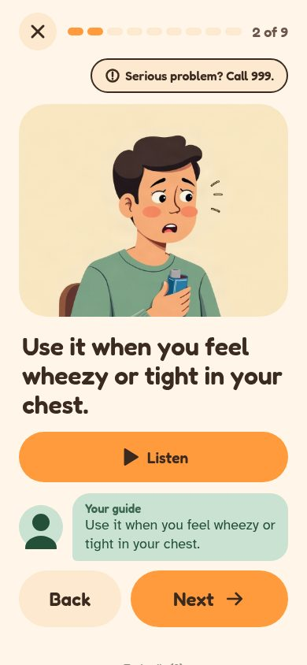 | `#/sample/inhaler/step/1` |
| Take care step (warning) | 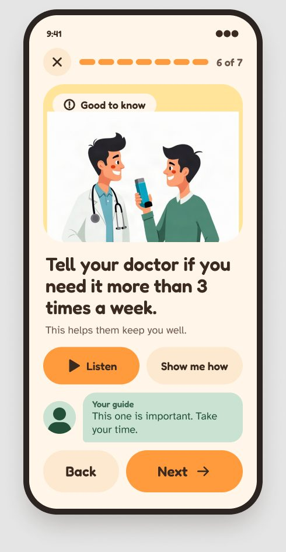 | 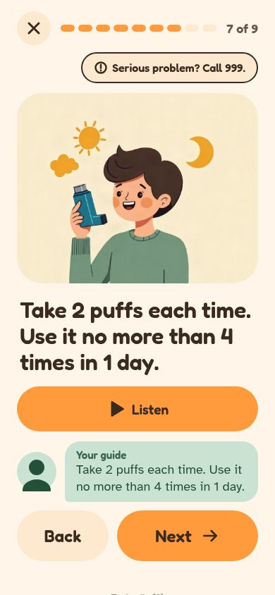 | `#/sample/inhaler/step/6` |
| Ask a question (voice or type) | 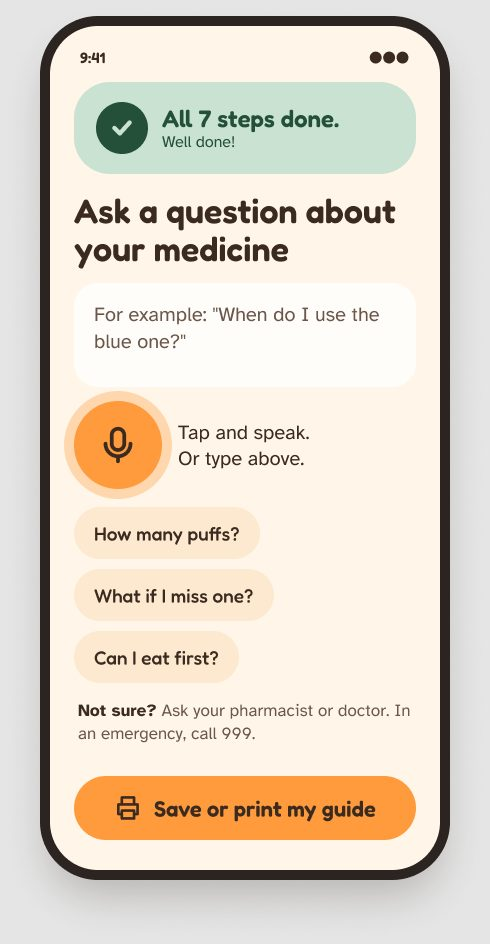 | 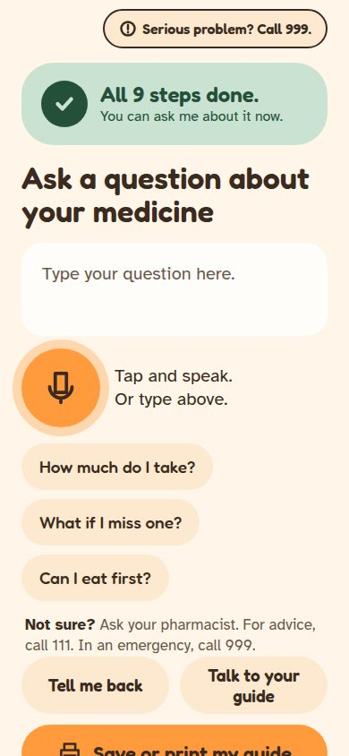 | `#/sample/inhaler/ask` |
| Check your photo | 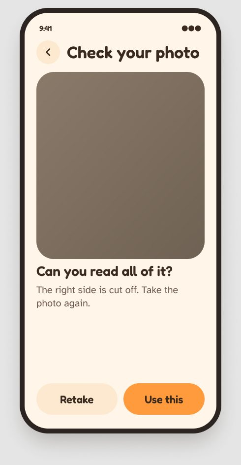 |  | `#/check/` |
| Your papers (tray) | 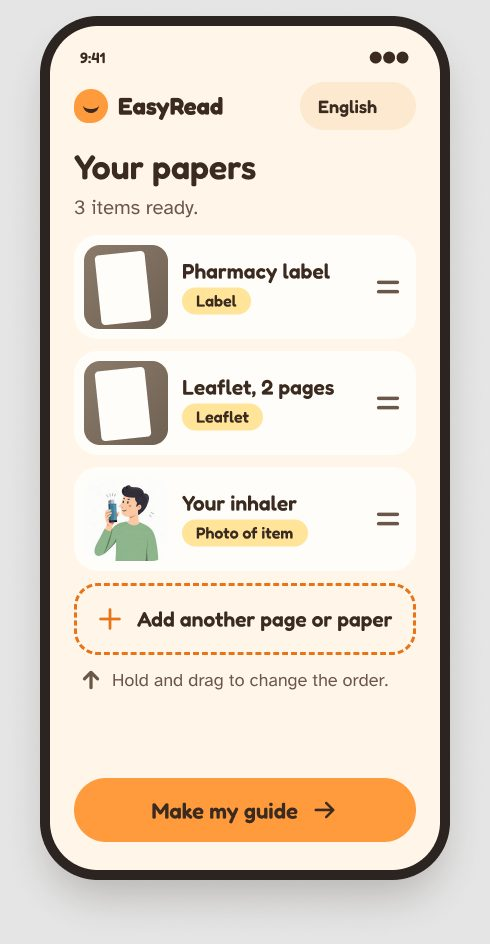 |  | `#/tray/` |
| Summary: your inhaler | 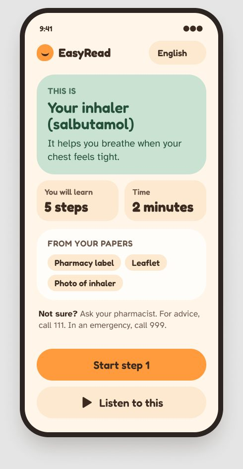 |  | `#/sample/inhaler/summary` |
| Summary: a letter (council) | 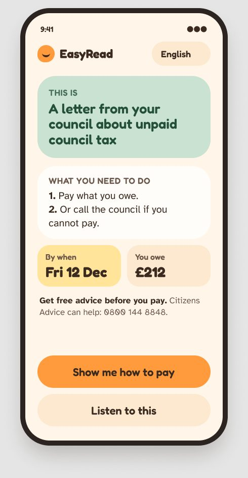 | 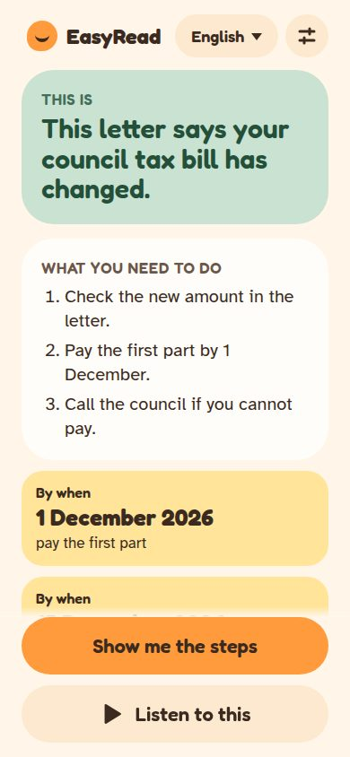 | `#/sample/council` |
| Annotated photo of your own device |  | _built, off by default (`DEVICE_PHOTO_LABELS=1`); no screenshot_ | `DEVICE_PHOTO_LABELS=1` |
| Show me how (technique clip) |  | 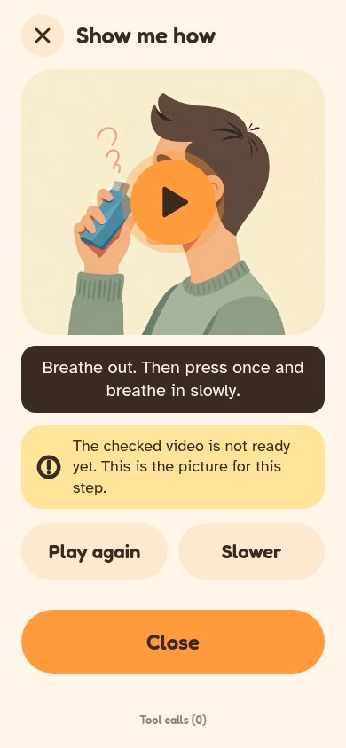 | `#/sample/inhaler/clip/3` |
| Talk to your guide (avatar) |  | 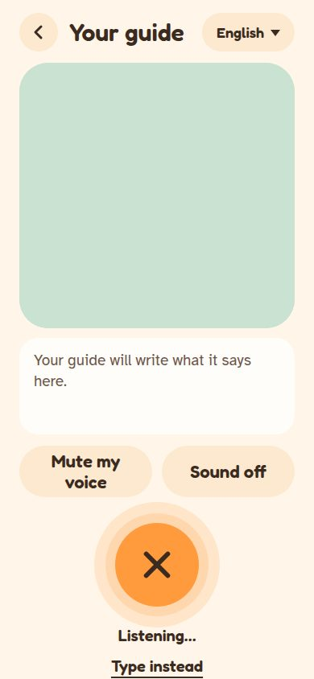 | `?fakelive#/sample/inhaler/talk` |
| Tell me back (picture choice) | 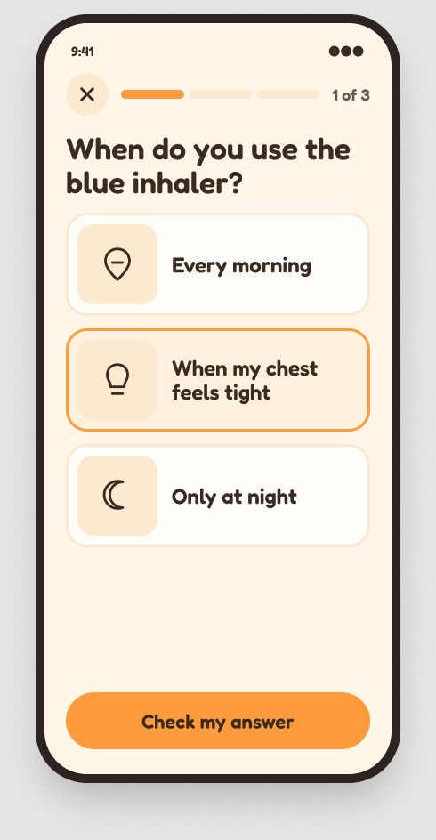 |  | `#/sample/inhaler/tellback` |
| Could not read that (error) |  | 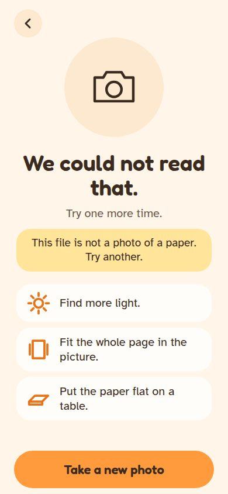 | `#/error/` |
| Settings (text size, voice speed, language, RTL) | 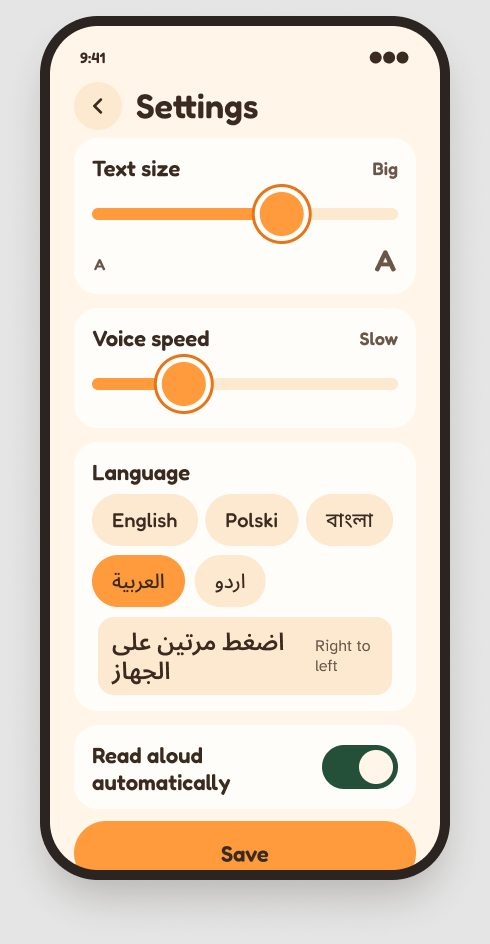 |  | `#/settings/` |

Extra built screens (no separate Figma frame):

| Screen | Built | Route |
|---|---|---|
| Bookshelf instructions summary | 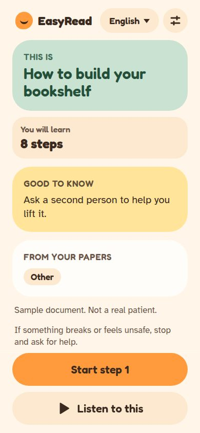 | `#/sample/flatpack` |
| Talk screen, before the avatar connects |  | `#/sample/inhaler/talk` |
| Step with the live avatar layout |  | `?fakelive#/sample/inhaler/step/1` |

## Designing for low literacy

- **Big type.** Body text 20px, steps 32px, titles 38 to 40px, buttons 22px, set in rem so the Settings text-size slider scales everything. Tap targets are at least 64px tall.
- **One step per screen.** One picture, one short sentence (15 words or fewer, from `docs/STYLE.md`), one big Next button. The step count ("2 of 9") sits on the progress bar.
- **Read-aloud everywhere.** A Listen button on every step, "Listen to this" on summaries, a read-aloud setting, and a talking guide (avatar). Every line the voice says also shows as a caption.
- **Wordless pictures.** Every step has one consistent illustration with no text inside it, so the same picture works in every language. Captions come from the interface in the chosen language.
- **999 always visible.** "Serious problem? Call 999." is on the home screen and a persistent link on every guide screen. Medicine guides end with the pharmacist, 111 and 999 lines.
- **Right to left.** Arabic and Urdu switch the whole layout to right to left (`dir="rtl"`). The Settings frame shows Arabic text with a "Right to left" label.
- **Honest states.** If the checked technique video is not ready, the app says so and shows the picture. Sample guides are labelled "Sample document. Not a real patient."
- **Plain words.** Buttons are verbs of one to three words ("Take a photo", "Use this", "Make my guide"). Errors say what went wrong and what to do.
- **Palette and fonts.** Warm cream background (#FFF6E9), dark brown ink (#3A2A20, high contrast), orange for the one main action (#FF9B3D), sage green for information (#C9E2D2 with #24503A text), butter yellow for take-care notes (#FFE49A). Headings and buttons in Fredoka, body text in Atkinson Hyperlegible, a typeface made for low-vision readers. The tokens are in `web/src/styles.css`; the writing rules are in `docs/STYLE.md`.

## Where the built app differs from the design

- The annotated photo of the user's own device (frame 10) is built but off by default (`DEVICE_PHOTO_LABELS=1` turns it on), because live tests put the labels beside the parts, not on them.
- The inhaler sample in the built app has 9 steps; the design shows 7.
- The talk screen captures show an empty green avatar area, because no live avatar session runs offline (`?fakelive` shows the layout only).
- The built app adds a small tool-call log at the bottom of screens.
