# Design evidence: Figma first, then built to match

Prize: Best-Designed AI Product (Figma).

Figma file: https://www.figma.com/design/tNc9gbdjtkrXMAgsvRT30w

## What is in the file now

One page, **EasyRead — Design story**, tells the whole design process top to bottom:

- **A. Early prototypes.** The first mock-ups and the 8 low-literacy principles we set ourselves.
- **B. Theme directions.** Three directions (A, B, C) explored side by side.
- **C. Chosen direction.** The guide-led direction we picked, why, and its flow map.
- **D. Colour variants.** Original, Calm, Fresh and Warm, each with the built Home and Step screens.
- **E. Final design (v4 Guide stage).** About 68 phone frames (390 x 844): home, camera and edge finding, crop with draggable corners and a magnifier, loading, guide intro, steps with animated close-ups, a letter step that highlights the printed words on the user's own photo, ask by voice and by typing, Read mode, You did it, My guides, first run and language, permissions, photo check, "couldn't read this part", "can't connect", "not on the paper", errors. Panels explain the animations (close-up loops, the avatar morph from full screen to the corner, highlights on the photo) and list the 9 Smart Animate prototype flows (main path, your own letter, first run, errors, any form, two papers disagree, Arabic and more). Ideas we dropped after testing are kept in their own small area.
- **F. Built.** Each final design next to a screenshot of the built app, and what changed after user testing.

The web app (`web/`) was built from the v4 frames. Colour, type and radius tokens are in `web/src/styles.css`.

**Where the built app differs from v4, after phone testing:** no check-in question after each step (the user moves with Back and Next); in guide mode the caption is what the guide says, with no second line of step text under the picture; the mic is off until the user presses Speak; "Check I've got it" is hidden for now; the old Summary screen and the Listen button were removed.

## Earlier version (v2), kept as design history

The table below is the earlier 15-frame version of the file (exports in `figma/`) next to the app as it was built then (`built/`). Several of these screens no longer exist in the final app (Summary, the Listen button, Tell me back).

Figma frames are exported from the file with the Figma API (`design/figma/`). Built screens are headless Chrome captures at 390 x 844 of the running app on its sample data (`design/built/`). The route column is the URL used.

| Screen | Figma frame | Built screen | Route |
|---|---|---|---|
| Home: take a photo, upload, samples | 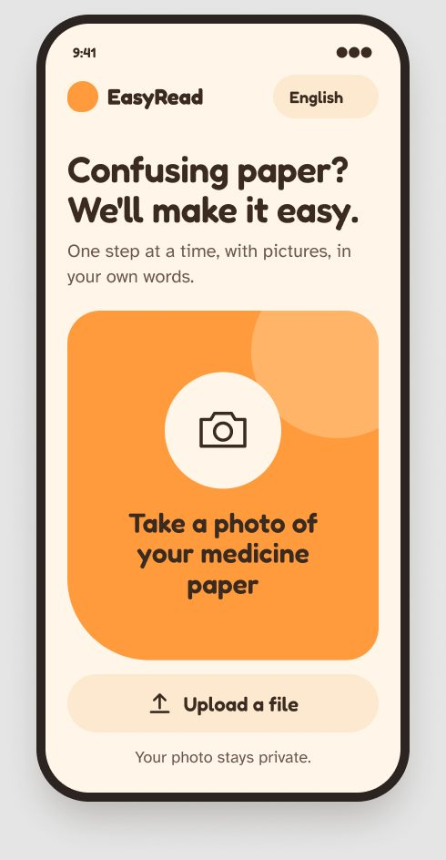 | 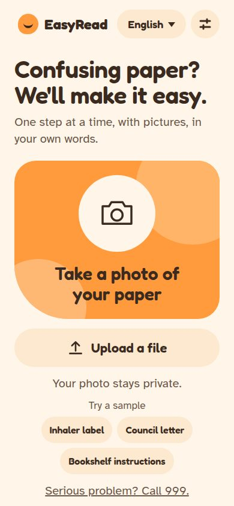 | `#/` |
| Making your guide (progress) | 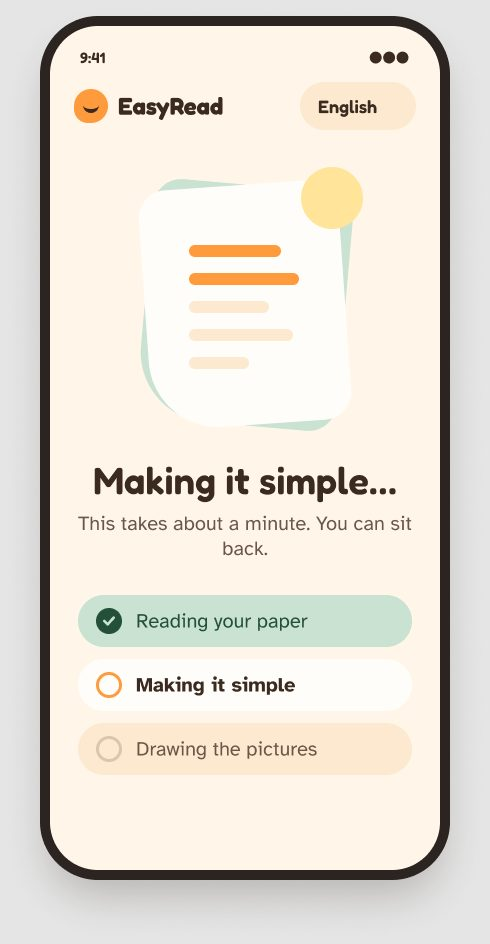 | 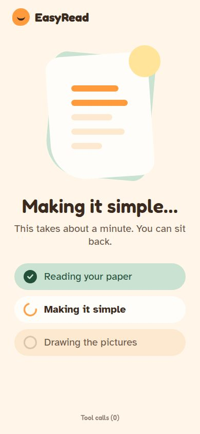 | `#/reading/` |
| Step: one picture, one sentence, Listen | 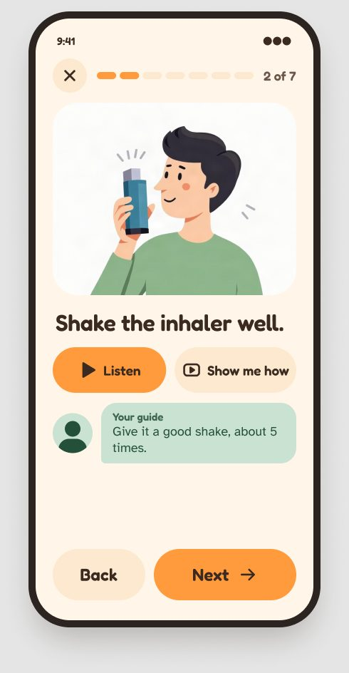 |  | `#/sample/inhaler/step/1` |
| Take care step (warning) |  |  | `#/sample/inhaler/step/6` |
| Ask a question (voice or type) |  |  | `#/sample/inhaler/ask` |
| Check your photo |  | 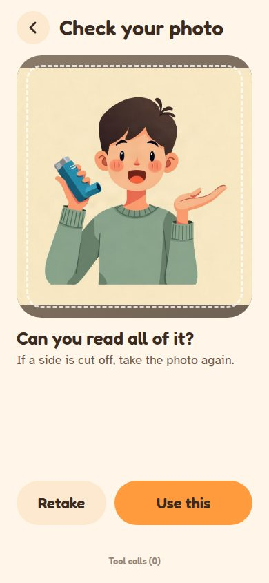 | `#/check/` |
| Your papers (tray) |  | 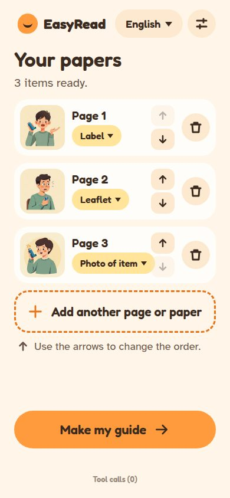 | `#/tray/` |
| Summary: your inhaler |  | 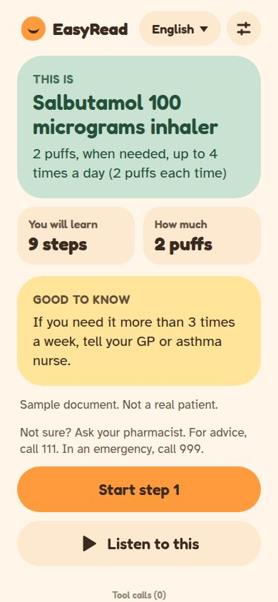 | `#/sample/inhaler/summary` |
| Summary: a letter (council) |  |  | `#/sample/council` |
| Annotated photo of your own device | 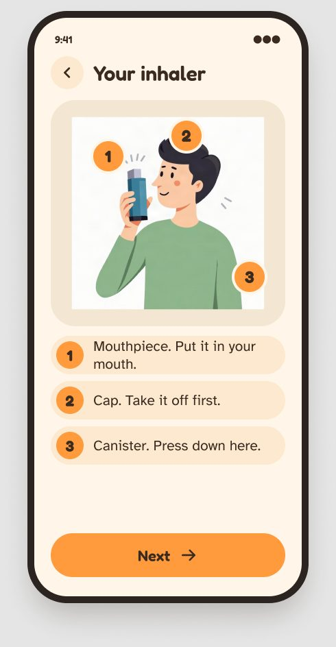 | _built, off by default (`DEVICE_PHOTO_LABELS=1`); no screenshot_ | `DEVICE_PHOTO_LABELS=1` |
| Show me how (technique clip) | 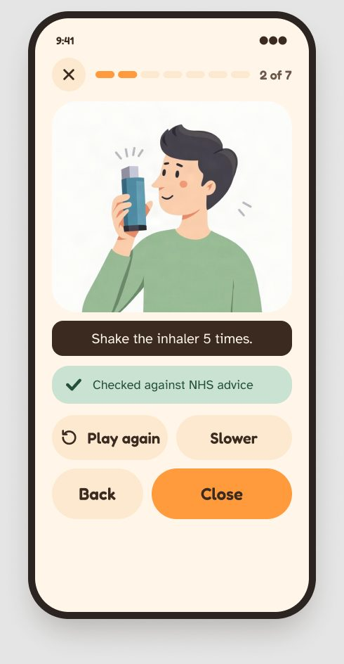 |  | `#/sample/inhaler/clip/3` |
| Talk to your guide (avatar) | 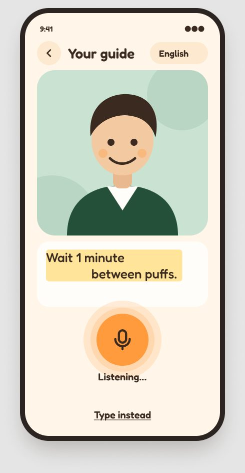 |  | `?fakelive#/sample/inhaler/talk` |
| Tell me back (picture choice) |  | 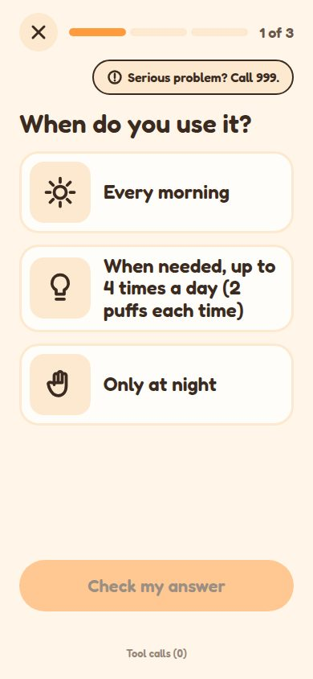 | `#/sample/inhaler/tellback` |
| Could not read that (error) | 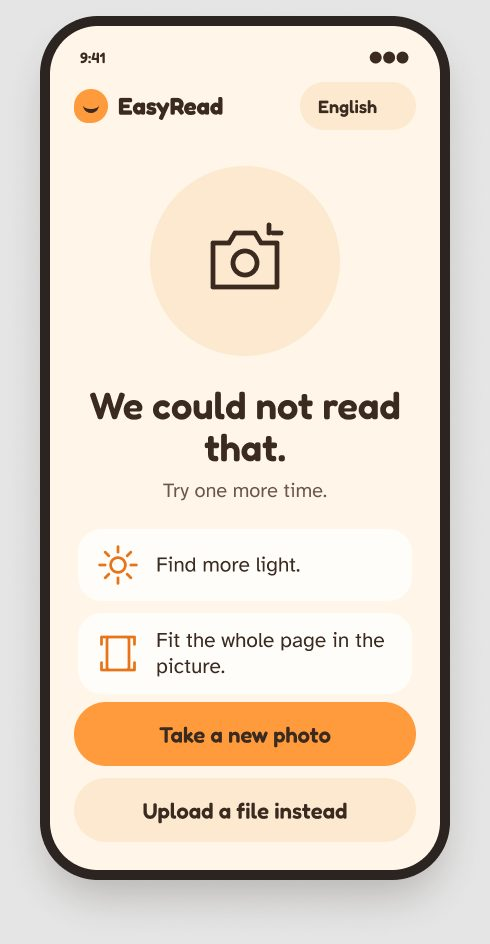 |  | `#/error/` |
| Settings (text size, voice speed, language, RTL) |  | 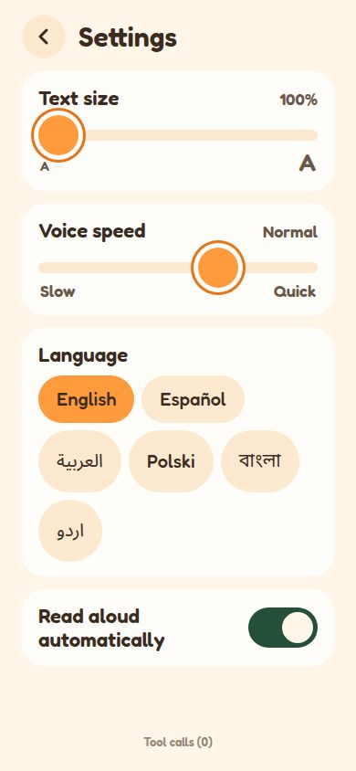 | `#/settings/` |

Extra built screens (no separate Figma frame):

| Screen | Built | Route |
|---|---|---|
| Bookshelf instructions summary |  | `#/sample/flatpack` |
| Talk screen, before the avatar connects | 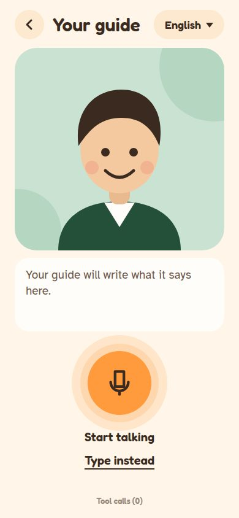 | `#/sample/inhaler/talk` |
| Step with the live avatar layout | 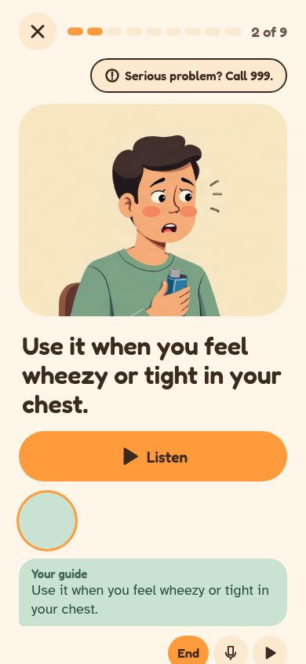 | `?fakelive#/sample/inhaler/step/1` |

## Designing for low literacy (final app)

- **Big type.** Body text 20px, steps 32px, buttons 22px, set in rem so the 5-step text-size setting scales everything. Tap targets are at least 64px tall.
- **One step per screen.** One visual, one short sentence (15 words or fewer, `docs/STYLE.md`), Back and Next always in the same place. A progress bar from step 1.
- **Spoken and shown.** The live guide speaks each step, and every spoken line shows as a caption. Read mode gives the same steps with no avatar and no sound.
- **Wordless visuals.** Animated close-ups, highlights on the user's own photo, and fal close-ups with no text inside, so a visual works in every language.
- **Right to left.** Arabic, Urdu and other right-to-left languages flip the whole layout, including the top bar.
- **Honest states.** "That's not on your paper" names who to ask; unreadable parts are shown; the app adds no advice of its own.
- **Plain words.** Buttons are verbs of one to three words ("Take a photo", "Use this photo", "Speak", "Type"). Errors say what went wrong and what to do.
- **Palette and fonts.** Warm cream background, dark brown ink (#3A2A20) for high contrast, orange for the one main action, sage green for the guide's words. Body text in Atkinson Hyperlegible, a typeface made for low-vision readers. Four colour themes (Original, Calm, Fresh, Warm).
